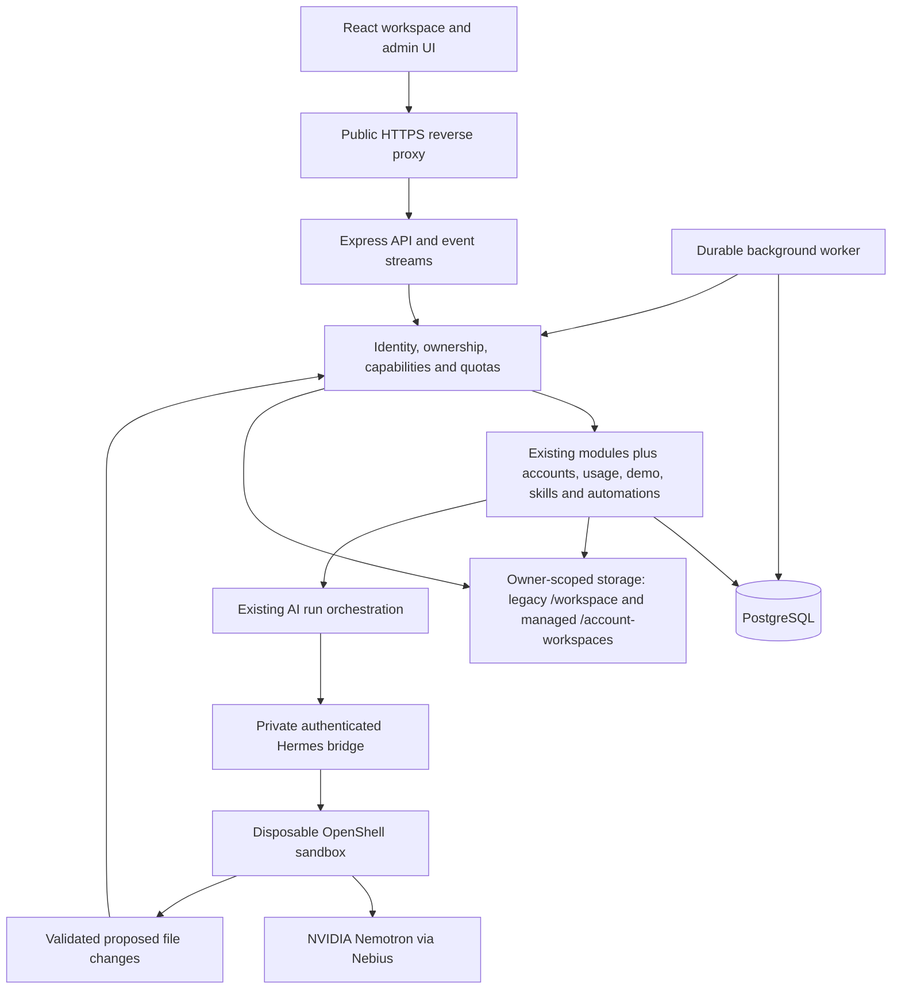

# Architecture: Personal AI Workspace hackathon release

Date: 2026-10-19
Status: Proposed implementation architecture; no application changes or deployment verified by this document.
Work order: [tasks.md](tasks.md). Application source root: `Personal-AI-Workspace/`.

## Change History

- 2026-10-19: Validated the complete release plan against the current checkout and historical Home/MVP architecture. Preserved numbered sections and task IDs. Added explicit backend/folder/contract boundaries, documented existing session authentication as a deliberate generic-skill deviation, and recorded implementation-time evidence dependencies. No application behavior or deployment is certified here.
- 2026-10-19: Resolved Task 2.2 storage mapping against the current Compose mount, workspace boundary, database migrations, and Hermes/OpenShell staging flow. The existing /workspace mount remains reserved for pre-existing legacy project roots; new file-backed projects use a separate optional /account-workspaces mount. Existing data stays in place. This is an architecture decision, not proof of a configured or deployed mount.
- 2026-10-19: Clarified the Task 2.2 active-principal dispatch boundary: expiry/disable committed before the guard blocks the next dispatch; a guard that passes first only admits that dispatch as in-flight and does not prove an atomic ordering with an external send.

## Decisions Summary

Both frontend and backend are in scope. Apply FSD to new frontend work and Clean Architecture to backend workflows; retain the modular monolith and existing explicit dependency injection. DDD and Hexagonal Architecture are excluded because this release does not require those additional modeling structures. Existing project identifiers, response envelopes, cookie sessions, runtime adapters, and file gateways remain the compatibility baseline. Add only structures required by an owning task.

## External Library References

Context7 is unavailable in this session (no callable Context7 tool). This validation introduces no dependency and relies on source inspection. [Docker Compose official services reference](https://docs.docker.com/reference/compose-file/services/), bind mount create_host_path topic (consulted 2026-10-19): long syntax with bind.create_host_path=false prevents Compose from creating a missing host source; the managed-storage overlay uses this guard. Task 5.3 must verify the installed React Router navigation-blocking API; Task 7.1 must verify any timezone helper; Task 8.1 must verify the selected deployment platform and actual mount source/target. Record exact library version/docs identifier or official documentation URL and topic in their developer evidence. Provider catalog/pricing/license verification remains Task 8.2; source model names are configuration observations, not a current vendor guarantee.

## 1. Goal and agreed scope

Deliver a workspace-first personal assistant with unobtrusive chat, direct task editing, automatic workspace-scoped tools, private one-click demos, account quotas, and demonstrable always-on workflows using the existing NVIDIA Nemotron / Nebius / Hermes / OpenShell stack.

The accepted demo design supersedes the initial shared-account proposal: each visitor receives a private temporary account/session and editable showcase copy, without sign-in. The operator's showcase remains read-only for visitors. Demo data expires 24 hours after session creation, rather than resetting every workspace hourly. A periodic cleanup worker removes expired data only. Numeric credit allowances and deployment coordinates remain operator settings, not invented commitments.

Additional scope accepted for this plan: scheduled daily briefings, a visible reusable Plan my day skill, inspectable persistent memory, workspace export, and clear disclosure of cloud inference. Account storage means persistent storage, not RAM or model context capacity.

## 2. Source baseline and limits of evidence

Inspected source and existing documentation establish these starting points; they do not prove deployed behavior:

- React/Vite/TypeScript frontend uses React Router, Redux Toolkit, Radix, and Tailwind. Existing widgets include `home-overview`, `home-chat`, `chat-workspace`, and `project-workspace`; features include `task-capture`, `task-actions`, `project-memory`, and `project-context`.
- Express/TypeScript backend has modules for auth, tasks, projects, memory, conversations, home-assistant, ai-runs, files, and action-ledger. PostgreSQL and TypeORM already persist much of the domain.
- `auth/repositories/user-repository.ts` exposes a single-active-local-user lookup. Multi-account login and demo identities require real changes, not just a new login button.
- Tasks already support owner-scoped access, nullable project membership, optimistic versions, subtasks, deadlines, ordering, and provenance. `project-task.ts` still includes archived status; global mutation routes offer archive, while a project-scoped delete use case exists.
- Project facts persist editable/deletable memory. Three bundled runtime SKILL.md files support planning, editing, and frontend design. A user-visible skill library and scheduled workflow system are new work.
- README documents Hermes in disposable OpenShell copies using `nvidia/nemotron-3-super-120b-a12b` via Nebius Token Factory, with direct NVIDIA inference as a fallback. Existing runtime controls include selected context, protected paths, egress redaction, validation, backups, and source-hash checks.
- Current Compose binds the app to loopback and uses configured TLS files; README describes self-signed local certificates. Public HTTPS needs a real domain and trusted certificate. Existing deployment helpers depend on the operator's installed WSL gateway and are not a portable cloud installer.
- Existing Home architecture requires per-turn/provider consent and proposal acceptance. This release intentionally replaces routine in-scope approval with stored policy and direct validated execution. Old architecture documents remain historical; this document governs these new behaviors.

## 3. System and deployment boundaries

Keep a modular monolith, PostgreSQL, and the existing agent bridge. Add one worker process from the backend codebase for schedules, demo provisioning recovery, quota reconciliation, and expiry cleanup. Do not introduce Redis, microservices, a second agent framework, or a new frontend state library for this release.



Only the public proxy is internet-facing. Database, bridge, OpenShell gateway, secrets, and authoritative storage are private. Keep the existing WORKSPACE_HOST_ROOT bind at /workspace for verified legacy project roots only. Base Compose does not require or mount managed account storage, so the app can run with planning-only and verified legacy file access. When managed file storage is enabled, use a separate compose.managed-storage.yaml override, following the existing compose.direct.yaml pattern; it requires ACCOUNT_WORKSPACES_HOST_ROOT and a distinct marker at /account-workspaces/.personal-ai-managed-storage-identity with an expected identity value, then bind-mounts the operator-provisioned source at fixed app path /account-workspaces with bind.create_host_path=false. Never select a default or inferred host source. Use persistent volumes and process restart policies; a sleeping laptop is not the final always-on deployment. Choose a persistent Linux host or another continuously running host compatible with the tested bridge. Preserve bridge mTLS and gateway-owned provider credentials.

UI-visible workspaces remain stored as projects internally. No project-to-workspace rename migration is needed. Home chat may operate across the current principal's mutable workspaces, with explicit targets in tool calls. Project chat and scheduled jobs receive narrower capability scopes. A global read-only showcase is a special published resource, never another user's unrestricted project access.

## 4. Frontend architecture and UX

Follow existing FSD: `app -> pages -> widgets -> features -> entities -> shared`. App shell/router/store live in app; routes compose pages; feature hooks own interactions; entity APIs and reusable presentation sit below them. No sibling feature deep imports. Reuse existing slices before creating new ones.

### 4.1 Workspace-first home and assistant launcher

- Remove the dominant inline Home assistant panel. Keep workspaces and Up next as the main content.
- Place a small chat icon with accessible name and visible `Ask` label at the bottom right. Its panel opens on click; it must not cover primary task controls when closed.
- Compose existing Home conversation/history logic into an assistant widget mounted once in the authenticated shell. Closing the panel preserves drafts and does not silently cancel active runs.
- Put the current conversation title/history dropdown in the panel header. From an open panel, a visitor can open history and select a conversation in at most two clicks. Include New conversation, loading, empty, error, and active-run states.
- Default the helper to Home scope; display selected workspace targets when applicable. Preserve the existing full workspace chat for substantial project work. Both paths use the same authorization and quota policy.
- Mobile: bottom sheet or full-height dialog above safe areas and virtual keyboard; desktop: bounded panel. Use Radix focus handling, Escape/close behavior, focus return, keyboard navigation, and polite streaming announcements without announcing every token. Suppress the helper on admin/login routes.

### 4.2 Task entry and task details

- Replace the prominent Inbox block with Add task and View all tasks in Up next. Keep unassigned tasks as valid storage records and accessible through All tasks; do not lose existing Inbox data. Workspace association is optional at capture.
- Opening task details immediately opens editable fields. No Edit button or preliminary edit mode. Save persists one validated mutation; Cancel discards local edits. Disable Save when pristine or submitting.
- Compare normalized editable values against the loaded version. Only dirty forms warn on close, navigation, task switch, or browser exit. Failed saves keep the draft. SPA navigation uses router blocking; hard exit uses the browser's native beforeunload warning where supported.
- Protect concurrent changes using existing task versions. A conflict offers reload/review without silently overwriting either draft. Task deletion during editing produces a clear unavailable state.
- Delete replaces archive in task details, lists, APIs, and agent tools. Keep completed status. A deliberate UI delete may use one confirmation; an explicit chat delete executes within its authorized scope without another approval dialog. Ambiguous chat targets require clarification, not permission.
- Audit spacing throughout Home, task details, task lists, workspace tabs, dialogs, chat, memory, skills, automations, and admin screens. Use existing spacing tokens with consistent field groups, block gaps, line height, button hit areas, overflow behavior, and responsive wrapping. Test long text, empty content, nested checklist rows, and narrow screens. Aim for WCAG 2.1 AA.

### 4.3 New navigation surfaces

- Login: existing sign-in plus equally obvious Try demo. Demo is a single click, not a shared password.
- Demo banner: temporary/private session, expiry time, remaining AI credits, and a link to usage. Explain that losing the session cookie loses access; never imply account recovery exists.
- Workspace tools: Memory, Skills, and Automations using existing navigation patterns. Avoid adding another large Home dashboard.
- Account settings: usage, storage, data/export controls, and cloud-provider disclosure. Admin portal is a separate protected route visible only to admins.

## 5. Identity, authorization, and automatic tools

### 5.1 Principals and isolation

Extend existing user/session persistence with account kind (`regular` or `demo`), role (`user` or `admin`), unique sign-in identifier for regular accounts, active/disabled state, and demo expiry. Keep hashed passwords for regular accounts; demo accounts have no password. Reuse secure server sessions with opaque HttpOnly, Secure, SameSite cookies, CSRF and Origin checks. Never accept account or owner IDs from the model/browser as authority.

Every query/mutation derives principal identity from the session or trusted job record. Scope tasks, workspaces, conversations, memory, events, runs, file history, exports, skill definitions, and scheduler history by that identity. Validate owner/workspace relationships in both use cases and database constraints where practical. Event streams and reconnect cursors receive the same checks. Admin status permits account management, not unrestricted file-tool access to other accounts.

For provider/tool dispatch, the active-principal guard must read persisted status and evaluate expiry against an authoritative clock. If disablement or expiry commits before that guard, suppress the next dispatch. If the guard succeeds first, only that dispatch is admitted as already in flight; a check alone does not prove atomic ordering with an external send. Recheck before each later dispatch and durable output/promotion. Keep any account-row lock limited to a bounded side-effect boundary; do not hold it across provider inference.

**Task 2.2 storage namespace.** The current WORKSPACE_HOST_ROOT bind mounted at /workspace is reserved for pre-existing legacy project roots. Backfill those project rows as storage_kind=legacy; keep their stored relative_root values and files unchanged, including the supported . root. Do not create new roots or place new data anywhere beneath /workspace.

Every new file-backed project, including one created by the bootstrap owner, uses the separate managed mount at fixed app path /account-workspaces. Persist storage_kind=managed and a server-generated relative_root suffix of projects/{projectUuid}; resolve its root from that suffix and the trusted owner UUID as /account-workspaces/{ownerUuid}/projects/{projectUuid}. Do not persist an absolute host path. The directory IDs and resolved paths are private storage details. Planning-only projects have no file root. A rootless legacy planning project that is later enabled for files receives a newly allocated managed root; the request carries no path.

Managed storage is optional deployment wiring. Without the managed-storage Compose override, or when its mount/marker is absent or invalid, the app has no managed root: do not fall back to /workspace, a temporary directory, the process working directory, or an inferred sibling. Managed projects report capabilities.fileAccess=false and file-backed create/root allocation fails with a retryable unavailable error. Verified legacy projects remain usable when the legacy mount is valid; planning-only work can continue when its other dependencies are available.

Provision the managed host directory and a distinct identity marker explicitly. Backend verification can establish that the configured fixed container target is a real directory, has the expected marker, and resolves to the expected in-container path; that alone cannot prove which host source Compose mounted there. Task 8.1 must inspect actual Compose container mount source/target and verify the two host roots are existing canonical directories, physically distinct, non-overlapping, and not symlink/reparse aliases. Do not claim that physical deployment verification before that evidence exists.

Migration backfills storage_kind=legacy only for pre-existing roots proven to belong to the bootstrap owner. If any other pre-existing account has files in the shared legacy mount, stop migration until an explicit per-owner mapping/copy is planned and verified; never map multiple owners to /workspace or move files implicitly. Resolve owner/project scope from trusted persistence at every file, tool, history, and promotion boundary. Reject traversal, absolute paths, drive/Unicode/case aliases, symlinks/reparse points, and cross-owner or cross-project overlap. Recovery data stays in the separate configured recovery area and cleanup uses an owner/project manifest, never a caller-supplied path. Do not expose arbitrary host-directory attachment to public users.

### 5.2 Stored permissions instead of repeated prompts

The product default is automatic read/write within the user's selected workspace scope. Configure the allowed provider, information sources, tools, and destinations in settings; display the cloud inference disclosure at entry/settings without a per-turn approval dialog. Selected-context exclusions still apply, and excluded/protected data cannot be recovered through a different tool.

Route Home tools, workspace tools, skill invocations, and scheduled jobs through common authorization and quota checks. Existing application tool handlers remain the execution boundary. Record tool actions and results in Activity with actual actor/source labels; do not label automatic writes as accepted by the user.

Remove routine provider-consent and proposal-acceptance UI/state transitions from the automatic path. Keep previews as information where useful. A direct request to create/edit/delete a task executes through the canonical mutation use cases, including version/idempotency checks. Unknown or ambiguous targets still need clarification.

OpenShell containment, redaction, command validation, file promotion checks, and credential protection remain mandatory. Automatic shell commands may run only in disposable owned copies with bounded time/output and allowed egress; they must never access the host, another account, or secrets. The release does not grant arbitrary internet destinations or remote side effects. Unsupported tools fail clearly instead of presenting recurring approval prompts. Retry/recovery cannot promote partial or stale output. Publishing the showcase, managing users, modifying quotas, or changing policies is unavailable to agent tools.

### 5.3 Showcase capabilities

Operator publishes a versioned, sanitized snapshot containing selected example tasks, memory, skills, and permitted files. Exclude secrets, private chat history, audit logs, and operator-only paths. Only the admin publishing action can update the canonical snapshot. Preview exactly what will be public.

Demo visitors may navigate and read the showcase but cannot mutate it, run chat against it, execute skills/automations there, or export its private source history. Enforce this server-side across every path, including background jobs, tool calls, files, task moves, and nested resources. The demo's editable copy has independent IDs, ownership, files, and provenance that contains no private foreign keys. Updating the showcase affects future copies, not existing sessions.

## 6. Private one-click demo lifecycle

1. Try demo sends a same-origin request. If a valid active demo session exists, resume it rather than granting new credits. Do not silently replace a signed-in regular account.
2. Atomically check persistent admission and network rate limits, provision a demo principal/session, and fix `expiresAt = createdAt + 24h` (configurable default). Browser refresh does not extend expiry.
3. Create one editable workspace from the current published showcase version. The request is idempotent; copying uses staging and a provisioning state. Failed/interrupted provisioning resumes or cleans up without duplicate workspaces/allowances. Do not report ready before its DB records and files agree.
4. Enter the editable workspace directly; optionally open the protected original through View showcase. No second Copy & try click is necessary.
5. Each AI operation consumes that session's allowance and the shared demo budget. Manual editing remains available when AI credits are exhausted until expiry. A global spending pause must not prevent read-only exploration.
6. On expiry, reject new authenticated demo operations immediately even if cleanup has not run. Cancel queued jobs, stop active runs, and deny late writes/promotions. Mark the session expired and offer a fresh demo subject to admission limits.
7. A recurring worker purges expired demo-owned rows, sessions, files, temporary exports, recovery copies, and sandbox resources using an ownership manifest. Use durable retryable cleanup states, resolved-path containment checks, and a last capability check before deleting. Never select the showcase or regular accounts by age. Show any operational cleanup lag separately from the fixed access expiry.

Anonymous abuse cannot be eliminated. Clearing cookies can create another identity if admission permits it. Persist per-IP/network new-session and AI-rate counters, trust forwarded addresses only from the configured proxy, and use bounded request/concurrency limits. Tune for shared judge Wi-Fi; do not bind a valid session rigidly to one IP. Do not introduce invasive fingerprinting. Short-lived hashed network identifiers are still sensitive operational data; define retention and avoid permanent identity tracking.

## 7. Credits, storage, and admin portal

### 7.1 Credit semantics and admission

Use integer credit units, never floating-point balances. One displayed credit represents a documented configured cost allowance; implementation records its conversion and model-price version. Calculate usage from provider input/output usage and all chargeable calls within a run. Display both allowance and consumed credits; do not promise an arbitrary number of messages.

Support daily and lifetime limits independently: `null` means unlimited; zero means no AI spending. Enforce the stricter remaining allowance. Daily windows use an account IANA timezone (default Asia/Shanghai for the existing operator); global demo budget uses a documented fixed timezone. Changes cannot reset already-recorded usage; apply timezone changes at the next defined boundary. Lifetime usage does not reset on logout or credential changes. Demo expiry is separate from daily resets.

Before inference, atomically reserve a bounded maximum cost against account daily/lifetime and, for demo, global demo daily and deployment-total campaign budgets. Lock budget rows in deterministic order. Hard input/output, iteration, and runtime caps must bound provider calls; a multi-step agent must acquire additional reservations before additional calls or stop. If the existing Hermes bridge cannot meter/bound all calls, extend it before public AI access. Do not treat a post-response usage counter as a spending limit.

Settle actual usage once with a unique run/call key and release only known unused reservations. Uncertain provider outcomes retain the reservation for reconciliation; cancellation is not evidence that no tokens were charged. Conservatively account for unsupported/unknown usage and disable admission if the configured price/bound is unavailable. Operator kill switch stops new demo inference. Global caps bound app-authorized spending; reconcile against provider accounting, which may have delayed reports or other users of the same key.

### 7.2 Storage accounting

Account limit covers persistent uploaded/generated files, stored conversations/messages, tasks, memory, custom skills, briefings, and retained recovery versions using a documented logical-byte measure. It excludes database indexes and shared curated template bytes; template copies count to the owning demo. Transient sandbox/export data has separate size and TTL limits. Do not market a logical-byte quota as exact physical disk usage.

Reserve positive byte deltas before uploads, record creation, and file promotion, with transaction-safe counters and maximum payload sizes. Credit released bytes only after deletion/reconciliation establishes success. Keep deletion and size-reducing operations available when over quota. If a limit is lowered below current use, block growth without deleting data. Run reconciliation and monitor actual disk space independently. Expose bytes and human-readable units; define 5 GB as 5,000,000,000 bytes.

### 7.3 Admin portal

Admin can list/search accounts, create regular accounts with securely hashed initial credentials, disable accounts/revoke sessions, reset credentials, set daily/lifetime credit limits and storage bytes, and inspect usage totals. Never display existing passwords or provider keys. Protect the last active admin from accidental removal/disable. Bootstrap the existing local owner as the initial admin exactly once, preserving their password and data.

A demo settings area controls allowance, lifetime, admission/concurrency limits, global daily/campaign budgets, and spending pause. Showcase publishing is operator-only. Record admin changes with actor/time/old/new limits, avoiding secrets and full personal content in audit logs. Active runs and workers recheck disablement and limits before further work and before applying output.

## 8. Persistent memory and reusable skills

Reuse project facts for workspace memory. Users can add/edit/delete and inspect facts, source, and whether a fact is included in AI context. Editing/deleting a memory affects future context; disclose that past conversation text and already-issued provider calls are not retroactively erased. New chats and scheduled runs load current permitted facts, not only the previous chat transcript. No vector database is needed for this release.

Add account-scoped skill definitions with optional workspace association, stable ID, title, instructions, enabled state, version, and declared tool needs. Seed Plan my day and Daily briefing templates; keep existing technical SKILL.md files as runtime implementation resources. Users can inspect, copy, edit, disable, and run personal skills without editing server files. Skill text is untrusted input and cannot expand capabilities, choose arbitrary providers, install itself as a host instruction, or access another account.

At invocation, snapshot the skill version and permitted context for reproducibility; record which facts and source revisions were used without duplicating unnecessary sensitive content. Plan my day reads selected tasks/deadlines and remembered working hours/priorities, then saves a useful plan in the workspace. Suggested changes are informational until the user asks to apply them, or explicitly chooses a skill whose declared operation includes those edits. No unnecessary approval step for authorized mutations.

## 9. Always-on daily briefings

### 9.1 Scheduling model

Add daily schedules with owner, selected mutable workspaces, skill ID, enabled state, local time, IANA timezone, next due instant (UTC), revision, and last-run status. Support create/update/pause, Run now, and history. Persist schedules and jobs in PostgreSQL; the worker runs independently of browser sessions. No email/calendar integrations are required for the first complete daily workflow.

Scheduler claims due occurrences transactionally, keyed uniquely by schedule ID and intended occurrence instant. Workers use leases, heartbeats, bounded retries, and unique result keys. Schedule edits/pause/disable/demo expiry are checked again at execution. Compute next due time in its named timezone: for nonexistent DST local times use the next valid instant; for repeated local times run once at the earlier occurrence. On downtime coalesce missed daily occurrences into at most one recent catch-up, then compute the next future occurrence. Do not replay an unbounded backlog.

Execution is at-least-once with idempotent result persistence, not a claim of exactly-once external inference. Interrupted inference with unknown billing is recorded as interrupted/unknown and reconciled rather than blindly charged and retried. Crashed workers cannot apply output after losing their lease. Avoid duplicate file promotions and task mutations with existing operation keys and source versions.

### 9.2 Briefing output

Daily briefing reads permitted tasks, deadlines, notes, and memory; saves a dated briefing with priorities and links to source tasks. Use the existing conversation/message store for the narrative plus a run result reference, avoiding a second document editor. Notify in app that new work is ready. Scheduled and Run now executions share the same skill/runtime, quota, context, and audit paths; manual invocations have their own idempotency keys.

Record queued/running/succeeded/failed/skipped-budget/cancelled/interrupted status, timestamps, model/provider, skill version, usage, and a concise explanation. Demo schedules can run only before expiry and within demo limits; Run now lets judges test without waiting until morning. Verify at least one actual scheduled occurrence with the browser closed and one restart recovery before release.

## 10. Data model and API evolution

Names below are logical additions; task contracts must map them to actual existing tables instead of duplicating them.

| Area | Persistence changes | Essential invariant |
| --- | --- | --- |
| Accounts/sessions | Extend users with identifier, kind, role, disabled/expiry fields; sessions reference principal | No anonymous client-selected owner or role |
| Account limits | Per-account daily/lifetime credits, storage bytes, timezone, revisions | Zero differs from unlimited; admin-only mutation |
| Usage | Window counters, reservations, immutable usage entries, reconciliation state | Atomic admission and unique settlement |
| Storage | Counters/reservations and resource accounting references | Concurrent writes cannot oversubscribe |
| Demo | Admission counters, provisioning/cleanup state, published snapshot/version reference | Private ownership; fixed expiry; curated data excluded from cleanup |
| Skills | Owner, optional workspace, instructions, enabled state, version | Skill text cannot widen policy |
| Automations | Schedules, occurrence jobs, leases, run/result references | Unique occurrence and fenced output application |
| Tasks | Canonical delete, removal of archive behavior, legacy migration map | Retain existing task content and prevent stale deletes |

Prefer existing route conventions and response/error envelopes. Task-level contracts own exact schemas, CSRF requirements, version headers, cursors, idempotency, and OpenAPI definitions. Proposed surfaces:

| Surface | Operations |
| --- | --- |
| Authentication/demo | Existing login/logout/session; POST demo-session create/resume; expiry-aware session response |
| Admin accounts | List/create/update/disable/reset credentials; read usage; update limits |
| Demo administration | Read/update demo settings; preview/publish showcase version |
| Tasks | Existing list/create/update/move plus canonical versioned DELETE; no public archive operation |
| Usage/settings | Current account credit/storage/expiry status; selected tool/context policy |
| Skills | List/read/create/update/disable/delete owned skills; invoke with idempotency key |
| Automations | List/create/update/pause schedules; Run now; read run history/results |
| Data export | Create/poll/download expiring workspace export for an owned mutable workspace |

Use validation and errors consistent with the repository (existing controllers use Zod; do not add class-validator because a generic checklist mentions it). Distinguish unauthenticated, forbidden/read-only, stale version, invalid input, quota exhausted, rate limited, expired session, and provider unavailable. Avoid leaking the existence of foreign resources through errors. Paginate histories/account lists; never expose other owners through counters or global search.

## 11. Migration, deletion, and retention

- Add compatible schema columns/tables first, bootstrap owner role/identifier, backfill ownership and quota counters, then enforce constraints and change application behavior. Validate existing ownership rather than assume every row is already safe.
- Back up PostgreSQL and authoritative files before executing migrations. Keep a written rollback boundary. Reversible schema migration does not recreate intentionally deleted user data.
- For Task 2.2, provision the managed host directory and marker before enabling managed roots. Backfill existing project rows to storage_kind=legacy only after verifying the bootstrap owner and current mount; new file-backed projects use managed roots under the second mount. Do not move or rewrite legacy files/relative roots. Abort the storage mapping migration if any existing non-owner root cannot be proven safe. Task 2.2 filesystem tests may inject an explicit isolated fixture mount; that does not prove the physical deployment bind. Task 8.1 owns verification of configured host sources, actual container targets, markers, permissions, and non-overlap. No such deployment verification is claimed here.
- Remove archive actions across UI, validation, API, tools, filters, generated contracts, and fixtures. Convert legacy archived tasks to done when completedAt is present, otherwise todo; preserve a migration mapping of prior status/timestamps for rollback. Do not delete archived tasks during migration. All tasks remains able to find converted tasks.
- Canonical delete must work for assigned and unassigned tasks, enforce expected version, and reconcile checklist, ordering, suggestion links, and action-ledger references. Prevent undo from resurrecting deleted tasks. Keep minimal operation receipts for replay handling, without retaining deleted task content indefinitely.
- Workspace export contains permitted files plus tasks, memories, conversations, skills, and schedules in documented portable JSON/file layout. Exclude secrets, provider credentials, other owners, internal recovery paths, and security logs. Exports require owner authorization at request and download, bounded size, expiry, and path checks. Protect against stale download links after demo expiry or account disablement.
- Define configurable retention for audit metadata, recovery versions, transient exports, and operational counters. Demo expiry deletes application-owned demo content and sandbox copies; disclose that backup retention and provider-side retention follow their own documented policies. Do not promise cloud erasure the application cannot enforce.

## 12. HTTPS, privacy, and release operations

Public deployment uses a controlled domain, trusted CA certificate, HTTP-to-HTTPS redirect, automated renewal, and an explicit public APP_ORIGIN. Validate event streaming and proxy timeouts. Trust only the actual proxy for forwarded headers; otherwise attackers can evade IP limits or forge origin/protocol assumptions. Secure cookies, CSRF, CORS, CSP, mixed-content checks, and websocket/SSE URLs must match the public origin. Enable HSTS after validating HTTPS/renewal; do not blindly preload a domain.

Local development may use an explicitly trusted local CA. A self-signed certificate with a warning bypass is not the public fix. Do not disable certificate verification or expose the WSL bridge to make deployment work. Exact host/domain/DNS/certificate setup is an implementation dependency; architecture work can proceed now.

State honestly: workspace data is stored on the operator-controlled deployment; selected context is sent to configured Nebius/NVIDIA inference. Show the active model/provider in settings and run details. Local-only inference is not included in this scope. Verify the published model catalog and license/provider terms during implementation; keep a successful real Nemotron run as release evidence.

Monitor worker heartbeat, queue lag, demo cleanup lag, quota reconciliation, provider errors, disk space, and certificate expiry. Logs omit credentials and full prompt bodies. Add readiness checks for DB and job infrastructure, retain existing runtime health visibility, and provide backup/restore and incident stop procedures. No live provider spending is required to write this plan.

## 13. Validation and release gates

Required evidence includes cross-account denial for HTTP/tools/events/files/exports/jobs; showcase immutability; concurrent quota/storage admission; token-cookie reset admission behavior; expiry versus active-run race; cleanup containment; task draft/save/conflict/delete behavior; no automatic-path approval prompts; memory use in a new chat; user-edited skill execution; browser-closed scheduled execution and restart; and a real Nemotron result.

Run existing pnpm typecheck/unit/integration/boundary checks plus focused Playwright journeys. Use the repository's actual package names. No linting tool is introduced. Screenshot representative desktop/mobile/keyboard states, especially task detail spacing and chat overlays. Record unavailable browser/MCP tools explicitly and use available Playwright CLI/browser inspection for equivalent evidence without claiming a missing tool ran.

Public access is gated on identity isolation, server-enforced quotas, showcase protections, expiry cleanup, and trusted HTTPS. The complete release also requires all UX, admin, data-control, memory/skills, and scheduler acceptance tasks. A feature flag can stage unfinished work privately but does not count it as complete.

## 14. Requirement traceability and decisions

| Requested outcome | Architecture | Tasks |
| --- | --- | --- |
| Small Ask helper; history in 1-2 clicks; workspace-first Home | 4.1 | 1.1, 5.1 |
| Add task/View all instead of dominant Inbox; consistent spacing | 4.2 | 1.1, 5.2, 5.4 |
| Automatic workspace-scoped chat reads/writes | 5 | 2.2, 4.1, 4.2 |
| Immediately editable tasks; Save/dirty warning; delete only | 4.2, 11 | 4.3, 5.3 |
| Fix Not secure | 12 | 8.1, 8.2 |
| One-click private demo; protected operator showcase; expiry | 5.3, 6 | 3.3, 3.4, 3.5 |
| Demo credits and resistance to repeated sessions | 6, 7.1 | 3.1, 3.2, 3.3 |
| Admin account creation, daily/lifetime credits, storage limits | 5.1, 7 | 2.1, 3.1, 3.2, 3.6 |
| Persistent visible memory; editable reusable skills | 8 | 6.1, 6.2, 6.3 |
| Always-on daily briefing, Run now, pause and history | 9 | 7.1, 7.2, 7.3 |
| Data controls/export; accurate privacy disclosure | 8, 11, 12 | 6.1, 6.4, 8.2 |
| NVIDIA model and hackathon demonstration | 2, 12, 13 | 8.2, 9.1, 9.2 |

Implementation-time inputs: deployment host/domain and DNS access; desired session/daily/campaign budgets; exact credit conversion/model pricing; regular-account default storage; showcase contents; retention settings. Use named configuration with explicit UI values, not hidden guessed limits. These inputs do not block writing contracts or implementing configurable behavior. They must be settled before public launch.

Out of scope: shared editable demo identity, arbitrary host access, unrestricted third-party actions, email/calendar integrations, vector search, local-only inference, subscriptions/payments, and a general workflow-builder UI. These are not required to complete the agreed release.

## Frontend Architecture (FSD): implementation boundaries

Section 4 governs UX; these boundaries map it to the inspected checkout. `frontend/src/app/routes.tsx` already uses a data router and composes `widgets/app-shell`; keep routing/providers/store in `app/`. Pages compose widgets/features through slice `index.ts` exports. Keep `home-chat`, `task-capture`, `task-actions`, `global-task-query`, `project-memory`, and `project-context` as the first reuse candidates. Account administration, personal skills, and schedules may add focused slices only when their tasks implement them.

Compose the Ask widget beside the shell outlet in app-level route composition or within an app-owned wrapper. Do not create a new sibling-widget import from `app-shell` to `home-chat`; `app/` or a page may compose both. Keep panel visibility/draft state at the persistent mounted owner, task edit drafts in the task feature, and server snapshots in their entity APIs/state. Existing upward imports of store hooks and sibling-widget composition are baseline debt, not an instruction to reproduce them or expand this release into a broad relocation. Move a shared dependency downward only when the changed flow needs it.

Entity APIs expose typed session/account usage, skill, schedule and run snapshots as needed. Generic fetch/envelope/error handling stays in `shared/api`; shared code must not encode account or scheduling rules. Admin route guards improve navigation only; the server remains authoritative. New DTO fields and event variants must reach the owning entity types, feature hooks, UI states and tests together.

## Backend Architecture (Clean Architecture)

Keep existing `backend/src/modules/{feature}/controllers`, `dto` where needed, `use-cases`, `domain`, and `repositories` boundaries. Controllers perform Zod/transport validation, derive authenticated request context, call use cases and map responses. Use cases coordinate authorization, ownership, quotas, mutation and receipts; domain types/policies stay free of Express, TypeORM, filesystems and provider clients. Repository/service interfaces live with the use case that needs them; infrastructure implements those interfaces. Never import ORM entities, Express request objects, or concrete infrastructure into use cases/domain.

Extend `auth` for principal/session lifecycle and admin identity operations rather than creating a second account identity store. Add cohesive `usage`, `demo`, `skills`, and `automations` modules only as their tasks land; keep existing task/project/memory/conversation mutations in their current owning modules. Cross-module orchestration consumes explicit application interfaces or exported use cases, never another module's controller or ORM adapter. Policy and quota checks are injected into existing canonical mutation/runtime paths, so HTTP, tools and workers cannot implement competing authorization rules.

`backend/src/composition-root.ts` already wires concrete adapters. Reuse it or a small shared factory for API/worker dependency wiring; keep worker startup separate from HTTP server startup. Background processing uses the durable schedule owner plus current account state, not a saved browser cookie or an expired login session. Recheck disabled/demo-expired status, schedule revision, capability scope, skill state and lease ownership before dispatch and output commit. Account shutdown and demo expiry invalidate work regardless of worker lease duration.

TypeORM repositories own SQL transactions, row locks, constraints and atomic receipts. Use cases request an atomic operation through a business-level contract; do not expose QueryRunner through domain interfaces. DB-only mutation plus quota reservation/receipt should commit together. Filesystem/provider effects cannot join a PostgreSQL transaction: persist pending operation identities and bounded reservations, then finalize or reconcile after the effect. Unknown results retain conservative accounting and cannot be retried as free work.

## Folder Structure

Paths below are recommendations for changed code, not a scaffolding checklist. Keep established filenames and only create segments used by the owning task.

```text
Personal-AI-Workspace/
  frontend/src/
    app/                         router, providers, store, shell/Ask composition
    pages/                       existing routes plus admin/settings/skill/schedule pages
    widgets/                     existing home-chat, home-overview, project-workspace
    features/                    existing task and context actions; new focused user actions
    entities/                    resource snapshots, entity APIs and shared business state
    shared/                      generic API, UI primitives, tokens and utilities
  backend/src/
    composition-root.ts          concrete API dependency wiring
    worker.ts                    separate worker entry point when Task 3.5 lands
    modules/
      auth/                      identity/session/admin workflows
      tasks/, projects/, memory/, conversations/, home-assistant/, ai-runs/, files/
      usage/, demo/, skills/, automations/   additions introduced by owning tasks
        controllers/, dto/, use-cases/, domain/, repositories/   only as needed
    infrastructure/
      database/entities/, database/repositories/, database/migrations/
      hermes/, ai-provider/, sandbox/, workspace/                existing IO adapters
    shared/                      generic errors, HTTP, logging and utilities
  deploy/                        existing private bridge and production deployment resources
```

## Key Interfaces & Contract Boundaries

| Boundary | Contract and responsibility |
| --- | --- |
| Browser -> API | Preserve `{ data, error }` envelopes, existing `/api/v1` route mounting and Zod validation. Publish exact request/result/errors in each task contract and `backend/src/openapi`; do not invent a second API version or auth mechanism. |
| Session -> use case | Resolve principal/session on the server; pass a typed trusted context rather than accepting client/model owner or role fields. Continue opaque HttpOnly cookie sessions plus Origin/CSRF checks. This intentionally overrides the generic API skill's JWT recommendation because the checkout already implements server sessions and SSE cookie authentication. |
| Tool -> application | Typed allowlisted commands call the same task/project use cases as HTTP. The runtime cannot choose its principal, broaden selected context or bypass expected versions/idempotency. |
| Application -> persistence | Interfaces express owned reads and atomic reserve/mutate/receipt operations. DB constraints include owner relationships, unique settlement/occurrence keys and indexes for owner/history/due-job queries. New migrations extend existing tables; validate backfills before constraints. |
| Application -> runtime | Extend existing `IAgentRuntime`, Home planning and provider contracts narrowly for bounded per-call admission/usage. Current `provider.usage` events alone do not prove admission bounds; Task 3.1 must cover every Hermes/fallback call, retry and cancellation uncertainty. |
| Worker -> application | Claim durable jobs with fencing; invoke the same skill/context/runtime workflows under current account policy. Persist a unique result reference before publishing a notification. Never use process-local events as the only record of a briefing. |
| Application -> files/export | A project-root resolver maps trusted owner/project records and persisted storage_kind to either the reserved legacy /workspace mount or the managed /account-workspaces mount. Existing gateways retain resolved-root containment, reparse checks, source hashes, backups and bounded promotion. The bridge receives only a bounded disposable per-run project copy through the existing /sandbox/pai-runs staging contract; it never receives a host path or mount. Stage/copy/export operations carry owner, operation identity, byte bounds and expiry; download and final promotion reauthorize. |

Typical data flow is feature hook -> typed entity API -> authenticated controller -> canonical use case -> policy/quota contracts -> repository or runtime/file adapter -> durable result/receipt -> response or authenticated event -> entity state/UI. Scheduled work enters at the same use case after a durable claim. Foreign IDs and showcase resources are rejected before data reaches inference. No browser/provider/runtime adapter is a policy authority.

Store evidence under the exact task artifact paths in `tasks.md`; developer summaries and tester Evidence Index must identify the invoked tool or unavailable tool, command/environment, redacted artifact and result. Missing MCP tooling may use the documented equivalent, but source inspection cannot replace required live inference, trusted public HTTPS, transaction race or browser-closed worker evidence.

## Risks & Future Considerations

Task 1.1 and configurable implementation can proceed without deployment coordinates or operator budgets. Public release remains blocked until host/domain/DNS/certificate control, actual provider pricing and complete call bounds, explicit allowance/retention settings, sanitized showcase content, and a working real runtime are established. These are unresolved inputs, not inferred failures of the installed environment; the developer owns its baseline checks.

High-risk seams are legacy-root mapping and managed-mount preflight, all-call Hermes metering, quota/file reconciliation, archive/undo migration, lease fencing and expiry races. Preserve the plan's negative/concurrency tests before exposing public access. A single API and worker process is the initial topology; horizontal scaling requires verifying existing process-local event delivery and workspace-write serialization first. No Redis, vector database, generic policy engine or workflow builder is justified by this validation.

### Release documentation versioning

The workspace root and `.codex/` are outside Git; the existing application repository is `Personal-AI-Workspace/`. Keep canonical working documents at their required `.codex/docs/hackathon-release/` paths. After an owning task receives QA PASS, include a reviewed snapshot of its relevant architecture/task/contract/UI/developer/QA documents in `Personal-AI-Workspace/docs/hackathon-release/`, preserving the feature/task subtree, in the same application commit as its implementation and tests. Copy only documents and explicitly reviewed evidence needed to substantiate the task; exclude secrets, raw prompts, credentials, database dumps, and large traces/videos. Do not initialize an outer repository or commit unrelated baseline changes.

A short README in the snapshot directory identifies the canonical workspace path, says snapshots are historical rather than a second editable source, and explains that source-relative links retain their canonical workspace context. Include checksums or artifact references for evidence retained only in the canonical evidence tree; absence from Git must not be presented as versioned evidence. Refresh only snapshots relevant to the passing change; QA failures stay in working documents until fixed. Task IDs and commit hashes remain in tracking documents; commit titles/bodies omit task numbers and tags as requested. This small, explicit copy step satisfies atomic reviewability without moving canonical agent documents, changing Git boundaries, or adding a synchronization subsystem.
