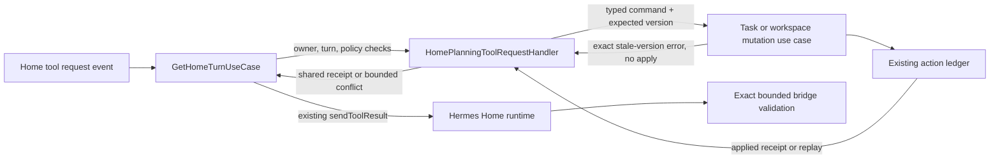

# Task 4.2 architecture preflight: direct Home actions

**Status:** Refreshed before implementation against delivered Task 4.1 and current Task 4.2 source. The provenance DTO/OpenAPI/Home Activity slice is now implemented. A bounded known-conflict tool result is approved by the appended architect decision; the current source mapping is documented below. This preflight remains architecture evidence, not test, migration, or runtime evidence.

## Decision

Keep `HomePlanningToolRequestHandler` as the one Home action boundary. Current code already dispatches typed single-action requests to the canonical task and workspace mutation use cases, which apply owner checks, optimistic versions, the action ledger, and Task 3.2 storage accounting. It derives assistant actor/turn provenance and a stable operation key from owner, turn, runtime request ID, and tool name. The remaining gap is that receipt/undo HTTP serializers and OpenAPI omit these persisted provenance fields and Home Activity displays a generic saved-action card. Task 4.2 should close that DTO/display gap with focused tests; it should not duplicate the working direct handlers, create a parallel Home mutation repository, apply task changes in a controller, or use proposal acceptance as the execution path.

Task 4.1 supplies the authorization needed to reach that boundary: bind the Home turn to its stored Home policy and, for a workspace target, that same owner's workspace policy; recheck active principal, policy revision, capability, credit admission, and storage readiness before each relevant provider/tool dispatch and durable write. Task 4.2 must preserve these guards. Existing fixed handlers map to the already-defined `home_task_write` and `home_workspace_write` capabilities; a new capability is not implicitly authorized by this task. Task 3.1 provider reservations and Task 3.2 storage accounting remain independent gates.

Execute one canonical mutation per typed tool request. When a turn needs several independent changes, dispatch them as separate bounded requests and retain a receipt for each applied change. Each mutation plus its ledger receipt and Home `action.receipt` pointer is atomic in its own database transaction; the group is not atomic. Do not send a synthetic success receipt for a failed/no-change action. Do not auto-apply, resume, or reinterpret persisted `home_change_proposals`; Task 4.1 retires their decision routes. Keep the current bulk proposal tool unavailable in 4.2: multi-action intent is a sequence of direct, single-action requests, not a new batch endpoint or an adaptation of the acceptance workflow.

## What 4.1 covers and what 4.2 adds

The delivered tool handler has direct typed handlers for task create/update/move/archive, workspace create/objective update, and action undo. These invoke canonical use cases. Task 4.1 allows only existing, policy-authorized capabilities to run automatically and removes the approval decision as authority. It does not turn the persisted bulk proposal/acceptance flow into automatic execution. Focused unit coverage already verifies direct task creation carries assistant attribution and the persisted turn ID, and that bulk proposal tools remain blocked.

Task 4.2 owns the remaining receipt contract/Activity behavior: preserve the existing direct typed action path, expose persisted actor/source turn through receipt and undo DTOs, and show truthful source/action labels in Activity. The provenance slice is now implemented. The immediate tool response includes a replay flag, but receipt metadata does not persist replay state, so Activity must not infer replay from a pointer. Only committed pointers create applied-action cards. A known canonical conflict currently becomes a blocked event in `GetHomeTurnUseCase.recordRuntimeEvents` and stops the turn without a bounded conflict result; a confirmed cancellation yields `cancelled`, while an unconfirmed cancellation yields `unknown`. The smallest proposed extension is a bounded known-conflict outcome through the existing immediate `sendToolResult` path after recognizing only known canonical conflicts; this is approved by the appended architect decision. Do not overload consent `denied/CONSENT_DENIED`, and do not claim current turn status already reports a conflict. Task 4.3 owns deletion and archive removal; Task 4.2 adds neither.

## Source map

| Boundary | Current source finding | Task 4.2 use |
| --- | --- | --- |
| Typed Home tool input | `Personal-AI-Workspace/backend/src/modules/home-assistant/use-cases/home-planning-command-validation.ts` uses strict Zod schemas. Direct updates/moves/objective changes carry expected versions. Direct targets are UUIDs; `workspaceRef` is accepted only by bulk proposal commands. | Keep strict action-specific input. Do not resolve names to arbitrary targets or reuse proposal-only references for direct calls. |
| Home action dispatch | `Personal-AI-Workspace/backend/src/modules/home-assistant/use-cases/home-planning-tool-request-handler.ts` checks active principal, owner-scoped conversation/turn, running status, and Home/workspace scope. Direct task/workspace cases call `ITaskMutationCommands` / `IWorkspacePlanningUseCases`; keys derive from owner, turn, runtime request ID and tool name. | Extend this use case only after the 4.1 guard/handoff. Derive owner/scope from the authenticated, persisted conversation; never from tool args. |
| Canonical task effects | `Personal-AI-Workspace/backend/src/modules/tasks/use-cases/task-mutation-use-cases.ts` normalizes commands, fingerprints requests, and invokes transaction participants through `IActionLedgerRepository`. Stale expected versions and operation-key reuse become conflicts. | Reuse create/update/move/archive. Preserve optimistic version and ordering checks and error mapping. |
| Canonical workspace effects | `Personal-AI-Workspace/backend/src/modules/projects/use-cases/workspace-planning-use-cases.ts` atomically creates a planning workspace or updates its objective through the action ledger, with active/owner/version checks. | Reuse create/update objective; do not attach arbitrary roots or broaden workspace/file capabilities. |
| Durable receipt and replay | `Personal-AI-Workspace/backend/src/infrastructure/database/repositories/typeorm-action-ledger-repository.ts` serializes `(owner_id, operation_key)` under an advisory transaction lock. Same key and fingerprint replay the receipt; same key with a different fingerprint conflicts. Mutation and receipt share a transaction. Migration `1710000021000-create-action-ledger-persistence.ts` has the owner/key unique constraint and persists `actor_kind`, `turn_id`, expected/pre/post versions, and outcome. | Preserve the existing ledger; no second idempotency store is needed for single actions. Reuse the exact runtime request identity on delivery retry. |
| Home Activity receipt | `Personal-AI-Workspace/backend/src/infrastructure/database/repositories/typeorm-home-action-event-recorder.ts` writes an `action.receipt` event in the mutation transaction. The event is a safe pointer to the receipt, not a full receipt. `action-undo-router.ts` currently omits `actorKind` and `turnId` from its receipt DTO; `HomePlanningRecords.tsx` renders a generic “Saved action.” | Expose the persisted actor/source in the receipt DTO and Home Activity. The current ledger already has the fields; a schema migration is not needed just to display them. Keep event payloads bounded and avoid recording tool arguments. |
| Proposal/approval path | `Personal-AI-Workspace/backend/src/modules/home-assistant/use-cases/home-change-proposal-use-cases.ts` persists review-required proposals, seals on acceptance, then executes items one by one with accepted/executing/partial/unknown states. The HTTP/UI acceptance and resume flows are in `home-proposal-router.ts` and `frontend/src/features/home-chat/`. | Do not call `accept`, resume, or backfill acceptance IDs for automatic work. Keep legacy records readable as history; new actions use direct tool requests and action-ledger receipts. |
| Policy and scope | `.codex/docs/hackathon-release/task-4-1-stored-tool-policy/contract.md` and `architecture-preflight.md` define `assertHome`, Home-plus-target-workspace intersection, current-revision checks, and fixed capabilities. | Task 4.2 consumes this contract; it does not edit policy profiles or grant showcase, admin, quota, or policy-management actions. |

## Target resolution, provenance, and conflicts

The server derives the principal from the session and the Home/workspace scope from the persisted conversation. In a workspace conversation, the target task/workspace must remain in that exact active workspace. In Home scope, every explicit workspace ID must resolve owner-scoped and active. The present direct create-task behavior treats an omitted workspace as Inbox (`null`); preserve that only as the explicit, documented Home default. In workspace scope, an omitted workspace means the conversation's workspace and an explicit different workspace is rejected. Never fuzzy-select among similarly named tasks or workspaces. If the user's wording does not identify one target, use bounded owner-scoped reads and ask a clarification before mutation. Proposal-only `workspaceRef` values are positional references to earlier workspace-create items, not global IDs.

Every Home-originated mutation must pass `actorKind: 'assistant'` and the persisted `turnId`; manual UI/API mutations remain `actorKind: 'manual'` with no turn. The durable action is assistant-originated even when the user requested it. It must never be labelled `accepted_by_user`, “you applied,” or as a proposal acceptance. The current `action.receipt` event only points to an action ID, so Activity should read the owner-scoped receipt and use its persisted actor kind; do not infer actor from the event name or tool text. Existing historical proposal/acceptance records remain historical and must not be rewritten.

For each tool request, retain the existing stable operation identity derived from `(ownerId, turnId, runtime requestId, toolName)` and the canonical request fingerprint. A replay with the same identity returns the original receipt without another version advance or event; changed arguments under that key conflict. A new model request ID is a new user-directed operation and must not be silently collapsed by content similarity. This gives idempotent application mutation replay, not exactly-once provider inference. On a transport/DB outcome that cannot be checked, do not invent a success or issue a fresh identity to repeat the action; resolve the same operation key through the ledger when available.

Use the canonical current target/version checks for updates, moves, and workspace objective changes. A stale version, foreign target, disabled/expired owner, revoked/changed policy, unsupported capability, or unavailable quota/runtime gate produces a safe non-applied result and no success receipt. A conflict must not reveal a foreign resource. A workspace create is a rootless planning workspace; file-root allocation remains governed by Task 2.2 and storage readiness.

## Implementation and verification handoff

The 4.2 developer contract should define only the direct action DTO/tool set, safe conflict/result codes, receipt fields/source label, and OpenAPI changes needed for any HTTP receipt response. Keep application workflow in Home use cases, validation in the existing Home command-validation domain boundary, and TypeORM/transaction behavior behind the existing mutation/ledger repositories. Frontend Activity belongs in the existing Home chat feature and consumes the action receipt entity/API; do not add an umbrella frontend slice. This follows the repository Clean Architecture/FSD/API/database guidance; DDD and Hexagonal Architecture are excluded.

No migration is needed for single-action idempotency or provenance: the action ledger already persists actor kind, turn ID, versions, and outcome. A small additive receipt DTO/event change is sufficient for the missing Activity label. If the contract requires a durable multi-action batch state beyond per-action receipts and the saved Home turn result, identify that as a separate persistence requirement; do not overload `acceptanceId` or pretend the old proposal's `partial` status means assistant-authorized work. Preserve the existing Task 3.2 logical-byte accounting when any new durable Home result/event content is added.

Before PASS, verify with focused unit and isolated PostgreSQL integration coverage:

- Same tool request delivery concurrently replays one receipt and one version advance/event; same key with changed arguments conflicts; an intentionally new request ID is a distinct operation.
- Stale task/workspace versions and ambiguous/foreign targets produce no mutation or success receipt; owner and active Home/workspace scope are revalidated.
- Mutation, ledger receipt, and `action.receipt` pointer commit or roll back together, including quota rejection; Activity resolves the receipt and displays `Assistant` for `actorKind='assistant'` without claiming user acceptance.
- A multi-action turn retains accurate receipts for completed operations and reports later conflicts/failures without claiming all-or-nothing rollback; cancellation or policy revocation prevents the next operation while already committed receipts remain accurate.
- Retired proposal/consent decision routes cannot execute or resume a proposal; ordinary history/receipt reads remain owner-scoped.

Task 4.1 is delivered and its retired consent/proposal write routes are blocked by the current implementation. Home chat still renders legacy proposal history read-only. Task 4.2 source inspection confirms the direct action path and ledger provenance already work; its focused implementation adds only safe provenance to existing receipt response shapes and labels the existing Activity card. These statements describe source/doc review, not runtime evidence.

---

# Task 4.2 architecture preflight: direct Home action conflict reporting

**Status:** Source-based decision for the Task 4.2 contract. This documents one known conflict outcome only; it is not runtime or QA evidence. No application source was changed and no tests were run.

## Decision

Keep direct Home mutations in the existing `HomePlanningToolRequestHandler`, which already calls the canonical task/workspace mutation use cases and returns their action-ledger receipts. Report a known stale-version conflict as a bounded result through the existing `IHomePlanningRuntime.sendToolResult` continuation. Extend the current result union by one explicit case, for example `{ outcome: 'conflict', code: 'VERSION_CONFLICT' }`, and let an immediate `HomePlanningToolResolution` carry that result. It has no receipt because the mutation did not apply.

Map only exact, known no-apply version-precondition errors from their canonical mutation call: `ProjectTaskVersionConflictError` (`PROJECT_TASK_VERSION_CONFLICT`) and `ProjectVersionConflictError` (`PROJECT_VERSION_CONFLICT`). Emit only the stable safe conflict code. Keep the catch at the mutation boundary. Do not infer safety from HTTP status `409`, return exception text, or convert idempotency reuse, policy, authorization, scope, validation, not-found, transport, or unexpected persistence failures into this result. Those paths retain the existing fail-closed behavior.

`GetHomeTurnUseCase` already rechecks the current stored policy before resolving a tool and again before sending its result. A conflict result follows that same check and existing runtime continuation. If authorization expires or changes, a handler result is unsupported, or sending the result fails, keep the current stop behavior: mark `cancelled` only after confirmed runtime cancellation; otherwise mark `unknown`. Do not send a synthetic conflict for those cases and do not continue after a failed or uncertain send.

Keep the existing direct-operation key derived from owner, turn, runtime request ID, and tool name. The canonical ledger continues to return the original receipt on an idempotent replay. Earlier successful actions keep their own exact receipts if a later action conflicts; the conflict adds no receipt and does not rewrite prior ledger history. This covers partial outcomes without a batch transaction, batch state machine, or durable action manifest.

The bridge contract must remain closed and bounded at every hop: TypeScript result type and Hermes runtime validator, Python `AcpSession._validate_home_tool_result` exact-key validation, and `runtime/home_tools.py` forwarding only the fixed conflict code. The bridge must reject unknown codes, extra fields, arbitrary exception text, and oversized values. The existing content-free `denied/CONSENT_DENIED` case remains a separate legacy consent response and must not stand in for a mutation conflict.

## Existing boundaries and ownership

Backend ownership stays inside the existing Clean Architecture module: Home application contracts and use cases describe the result; the existing Hermes infrastructure adapter validates and transports it; the bridge accepts only the fixed result union. No controller, public REST route, schema migration, repository implementation, or new runtime channel is needed for this conflict outcome. The separate receipt/source-label DTO and OpenAPI work remains with the Task 4.2 developer contract owner.

Frontend work, if needed for receipt/source labels, stays in the current Home chat / activity and action-ledger entity slices under FSD. Consume the owned DTO through existing public APIs; do not add a parallel Home state framework or deep-import another slice. The conflict response itself is an internal model-tool result and does not add a frontend endpoint.

Expected source/test touch points for the bounded conflict path are:

- `backend/src/modules/home-assistant/repositories/home-planning-runtime.ts` and `repositories/home-planning-tool-request-handler.ts` for the closed contracts.
- `backend/src/modules/home-assistant/use-cases/home-planning-tool-request-handler.ts` for exact version-error mapping around canonical mutations; `get-home-turn.ts` should keep its existing policy, continuation, and cancellation flow.
- `backend/src/infrastructure/hermes/hermes-home-planning-runtime.ts`, `deploy/hermes-bridge/acp.py`, and `deploy/hermes-bridge/runtime/home_tools.py` for bounded validation and forwarding.
- Existing focused coverage in `home-planning-tool-request-handler.spec.ts`, `get-home-turn.spec.ts`, the Hermes Home runtime spec, and `deploy/hermes-bridge/tests/test_planning_runtime.py` for stale task/workspace version errors, applied/replayed receipts, exact conflict payload validation, and failed-send cancellation/unknown behavior.

## Scope exclusions and references

This is a backend/runtime contract change; no database design or migration is in scope. FSD applies only if the separately owned receipt/source-label DTO changes reach existing UI slices. Clean Architecture, API design, FSD, and Ponytail guidance were read. The Task 4.2 MCP inputs are N/A; no Context7 or external library guidance is needed. DDD and Hexagonal Architecture are excluded because this is a small extension to existing module contracts and call paths, not a new domain model or adapter framework.

## Risks and limits

Source inspection confirms the current blanket catch and bridge allowlist, but does not prove live Hermes continuation. A failed or timed-out result send can leave the model-side outcome uncertain; keep the turn `unknown` unless cancellation is confirmed and rely on the existing deterministic operation key plus canonical ledger for retries. If a future action can partially commit inside one canonical mutation call, it needs its own explicit receipt/result contract before its exception can be mapped as a known conflict.
