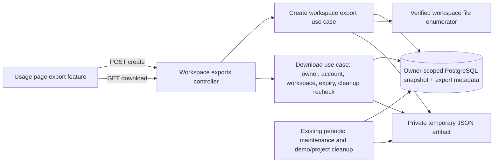

# Task 6.4 Workspace Export Architecture Preflight

## Change History

- 2026-10-20: Source-only bounded export decision based on release architecture §§4.3, 7.2, 11, Task 6.4, existing ownership/storage/memory/skills contracts, and the current Task 7.1 contract/schema. No application code or tests were changed or run.

## Scope and decision

Task 6.4 adds a portable export for one owned, active, mutable workspace and an Export section in the existing `/usage` page. Keep the current credit/storage display and account-usage API. There is no import feature, archive dependency, generic job framework, or new settings framework. DDD and Hexagonal Architecture are excluded because this fits the existing modular monolith and Clean Architecture boundaries. No vendor API or new library is needed; Context7 is not required.

Task 7.1 remains in progress. Its contract and migration `1710000038000` are the current scheduler source of truth for this preflight; the developer must reconcile the final 6.4 contract with its delivered schema and cleanup wiring before implementation.

Use one versioned JSON document, not a ZIP. Include file bytes as base64 entries so arbitrary permitted files survive a parser round-trip without an archive package:

```json
{
  "manifest": {
    "format": "personal-ai-workspace-export",
    "version": 1,
    "createdAt": "<ISO-8601 UTC>",
    "databaseSnapshotAt": "<ISO-8601 UTC>",
    "filesReadStartedAt": "<ISO-8601 UTC>",
    "filesReadCompletedAt": "<ISO-8601 UTC>"
  },
  "workspace": { "id": "<uuid>", "name": "...", "objective": "..." },
  "files": [{ "path": "src/main.ts", "encoding": "base64", "sizeBytes": 12, "sha256": "...", "content": "..." }],
  "tasks": [],
  "memory": { "facts": [], "context": {} },
  "conversations": { "project": [], "home": [] },
  "skills": [],
  "schedules": []
}
```

Export only the selected workspace's current task/fact/context/conversation data, workspace-bound skills, and schedule definitions. Do not include account-wide skills, other workspaces, provider/session credentials, workspace owner IDs, host paths, recovery trees, action/audit/security logs, idempotency digests, scheduler lease/fence state, or skill invocation internals. Preserve record IDs and existing task/fact/skill versions, conversation sequence values, and schedule revisions where present. Schedule history remains available in its existing Home transcript and is not duplicated into the export.

## System and lifecycle



Create synchronously within a hard request deadline. Register a `building` export row before writing bytes, write to an exclusive private temporary file, then atomically publish it and mark the row ready only after rechecking the active owner, mutable workspace, and captured cleanup generation. Any failure or limit hit removes the partial file and leaves no downloadable artifact. The artifact row stores only its generated UUID, owner/workspace IDs, lifecycle status, expiry, byte count, cleanup-generation binding, and hashed idempotency key/request fingerprint; derive its filename from the UUID beneath a private `os.tmpdir()` subdirectory. Never accept or store an absolute path.

`POST /api/v1/workspace-exports` accepts a strict `{ "workspaceId": "<uuid>" }` body, authenticated session, same-origin/CSRF checks, and an `Idempotency-Key`; the owner comes only from the session. It returns the ready artifact ID, workspace ID, size, and absolute expiry in the existing response envelope. An exact retry while that artifact remains ready returns the same descriptor; a key reused for another workspace conflicts, and an expired replay requires a fresh key. `GET /api/v1/workspace-exports/{exportId}` is a binary download with `Content-Disposition`, `Cache-Control: no-store`, and `X-Content-Type-Options: nosniff`.

Both creation and download resolve the selected workspace by `(session ownerId, workspaceId)` and require it to remain active, mutable, and outside a project-removal job. Download additionally requires the artifact to be ready and unexpired, the account/session to remain active and unexpired, and the artifact's cleanup generation to remain current. Demo expiry/disablement, workspace removal, expired/foreign/missing IDs, and stale cleanup generations fail closed; return the same non-enumerating 404 for unavailable/foreign artifacts. The existing authenticated session middleware remains authoritative for disabled and expired principals.

Set a 15-minute artifact TTL from successful publication. Existing periodic maintenance removes expired/failed files and metadata; startup reconciliation removes orphaned partial files and marks missing artifacts unavailable. Demo-expiry and project-removal cleanup capture exact export IDs, fence builders before publication, wait for in-progress writes to become terminal, unlink those artifacts, and only then finalize owner/workspace purge. Export rows must prevent hard owner/workspace deletion until their temporary files are confirmed removed. These cleanup references are transient artifact lifecycle metadata, never included in the export.

## Bounds and consistency

- At most 1,000 regular files; at most 8 MiB per file, reusing the existing file download cap; at most 16 MiB of raw file bytes total.
- At most 8 MiB of structured JSON data and 32 MiB for the final serialized JSON. Cap database row/page reads as well as the completed document; never silently truncate. Exceeding any bound returns a stable `413 EXPORT_TOO_LARGE` and removes partial bytes.
- One bounded 60-second create deadline; stop file enumeration/reads when reached and clean up the partial artifact.
- Allow at most two unexpired artifacts per owner; a third create returns `429 EXPORT_LIMIT_REACHED`. Keep exports outside `/workspace`, `/account-workspaces`, and `RECOVERY_ROOT`. Do not count transient export bytes in persistent account storage quota; enforce these independent size, active-count, and TTL limits.
- Read structured rows through one read-only repeatable-read snapshot and record its timestamp. Capture files through the verified workspace root separately and record the file-read start/end times and per-file hashes. The manifest reports these revisions/timestamps honestly; database and filesystem contents are not an atomic snapshot.

The existing `WorkspaceGateway.tree()` is not a complete export inventory: it is depth/entry limited, filters out binary files and unsupported text files, and reports truncation. Add one narrow export enumeration/read operation at the existing workspace/file boundary. It must derive scope from the owned persisted project and reuse `WorkspaceRelativePath`, protected-name/segment rules, root resolution, storage-kind checks, regular-file checks, reparse/symlink rejection, and no-follow reads. Exclude protected secret/config/recovery names and known credential material through the existing secret helpers. Unsafe paths, changed files, read errors, or incomplete traversal fail the whole export; do not silently produce a partial bundle. Only relative normalized paths enter JSON.

## Layer boundaries and source map

**Frontend (FSD).** Keep `/usage` in `src/pages/usage/` as the route composition and reuse `src/entities/account-usage/` for existing usage DTO/state. Add a focused `src/features/workspace-export/` slice for workspace selection, create/download state, and its API; reuse the existing owned-workspace entity/API. Do not move business export logic into `shared/` or add a global settings abstraction.

**Backend (Clean Architecture).** Add `src/modules/workspace-exports/{controllers,dto,use-cases,domain,repositories}`. The controller authenticates and parses only transport input. The use cases own eligibility, lifecycle, limits, and failure behavior. Repository ports cover export metadata and a bounded owner-scoped structured snapshot; an infrastructure adapter reads explicit DTO projections in one database snapshot. A narrow file-export port sits beside the existing files module and is implemented in `src/infrastructure/workspace/`, using the existing trusted workspace-boundary/path-resolution code. A private artifact-store adapter handles temporary create/read/unlink. Composition lives in the existing composition root and authenticated app router.

Existing references to reuse:

- Workspace ownership/root/path/file behavior: `backend/src/modules/projects/use-cases/get-project.ts`, `modules/projects/repositories/project-repository.ts`, `modules/files/domain/workspace-path.ts`, `modules/files/domain/workspace-policy.ts`, `modules/files/repositories/project-file-access.ts`, `infrastructure/workspace/project-file-gateway.ts`, `workspace-gateway.ts`, and `workspace-gateway-paths.ts`.
- Structured export source shapes: `infrastructure/database/repositories/typeorm-project-task-repository.ts`, `typeorm-project-fact-repository.ts`, `typeorm-conversation-repository.ts`, `typeorm-home-conversation-repository.ts`, `typeorm-skill-repository.ts`, and `typeorm-automation-repository.ts`. Apply their existing owner/workspace constraints; serialize explicit user-facing projections, not persistence rows.
- Persistent usage: `frontend/src/pages/usage/UsagePage.tsx`, `frontend/src/entities/account-usage/`, `backend/src/modules/admin-portal/controllers/admin-portal-router.ts` (`GET /account/usage`), and `modules/storage-quotas/controllers/account-storage-router.ts` (`GET /account/storage`). Export bytes stay separate from the existing logical-byte quota.
- Cleanup integration: `backend/src/modules/demo/use-cases/cleanup-expired-demos.ts`, `infrastructure/database/repositories/typeorm-demo-expiry-cleanup-repository.ts`, `modules/projects/use-cases/delete-project.ts`, `infrastructure/database/repositories/typeorm-project-removal-repository.ts`, and existing periodic maintenance. Preserve Task 3.5's cleanup fence, exact-ID manifest, and purge receipt patterns.

The export module depends inward on ports; TypeORM, Express, filesystem APIs, and response headers stay in outer layers. No new table is needed for payload contents. One additive metadata migration after Task 7.1 migration `0038` is needed for durable export lifecycle/owner/workspace cleanup references; it stores no export content or host path. DDD and Hexagonal Architecture remain excluded.

## Focused implementation proof and evidence

The developer-owned Task 6.4 contract should keep these checks focused on the stated security and lifecycle gates:

1. A fixture containing one permitted text file, one permitted binary file, task, fact/context selection, project and Home conversation messages, workspace-bound skill, and schedule parses as format version 1; decoded base64 bytes match the source exactly and existing revision/sequence values are preserved.
2. A file-count, per-file, aggregate-file, structured-data, final-document, and deadline overflow returns the documented bounded error; there is no ready row or leftover partial artifact.
3. An expired artifact and a stale demo-cleanup generation cannot download; successful expiry cleanup removes the file and metadata.
4. A disabled/expired account is rejected by existing authentication, a removed/archived workspace is rejected by current project checks, and a foreign artifact ID has the same non-enumerating response as a missing one; no file is opened on denial.
5. Fixtures containing `.env`, `credentials.json`, `.personal-ai/recovery`, a private key path, known provider credential material, and audit/recovery rows do not appear in the bundle. Do not claim heuristic checks can detect arbitrary secrets saved in user-authored content.
6. Traversal, symlink/reparse entries, a file changed during capture, and incomplete enumeration never produce a downloadable partial artifact.

Task 6.4 requires later Playwright evidence for create/download/error/expiry and usage/storage settings, plus Chrome DevTools evidence for download authorization and cache headers. The current architecture preflight uses no MCP, browser, PostgreSQL, or test runner and makes no runtime/QA claim. If browser MCPs are unavailable, record that in the owning task artifacts and use the evidence route allowed by `tasks.md` without claiming a missing tool ran.

## Risks and future considerations

The export artifact is temporary and local to the current application container. A container restart can discard a still-listed artifact; the download path must detect this and ask the user to prepare a new export. If the API becomes multi-replica or exports must survive deployment replacement, move artifacts to a shared private store with the same owner/expiry/cleanup fences. Never silently raise the byte/file limits or treat the resulting JSON as a cross-table/filesystem transaction.

## Builder liveness and crash recovery ruling

The contract requires startup recovery to mark a `building` export terminal only when the previous writer is provably gone; elapsed time, request deadline, or cleanup wait timeout is not proof. The current deployment target is one local API/container on a persistent Linux host, and the existing workspace boundary already uses `/proc/self/fd` for pinned file access. Keep liveness process-local and narrow: store the builder PID plus its Linux `/proc/<pid>/stat` start-time ticks in the export metadata when the `building` row is registered before file I/O. Read the current process start marker once at startup and reuse it for builders.

On startup, reconcile a captured `building` row as abandoned only when its PID is absent (`ENOENT`/`ESRCH`), or `/proc/<pid>/stat` exists but has a different start-time marker, proving that PID was reused and the recorded writer exited. A matching PID and marker means the writer may still be active, so leave the row building. Permission errors including `EPERM`/`EACCES`, missing or malformed markers, and any other uncertain probe leave the row nonterminal and cleanup pending; never unlink its partial/final file or continue owner/workspace purge. If the current process cannot read its own marker, it must not begin an export builder. Do not use PID alone, a timestamp/deadline, DB lock loss, or a new process registry/lease framework as a substitute for writer identity.

Keep the recovery proof to one focused unit test around an injectable process-identity reader: absent prior PID becomes recoverable; a reused PID with changed start ticks becomes recoverable; matching identity remains building; `EPERM`/`EACCES` and malformed/unavailable markers remain pending. Assert that only the two proven-gone cases can proceed to artifact cleanup/terminal failure. Retain the existing exact-ID demo/project fences and terminal-writer waits; do not add a general platform matrix or PostgreSQL test matrix.
